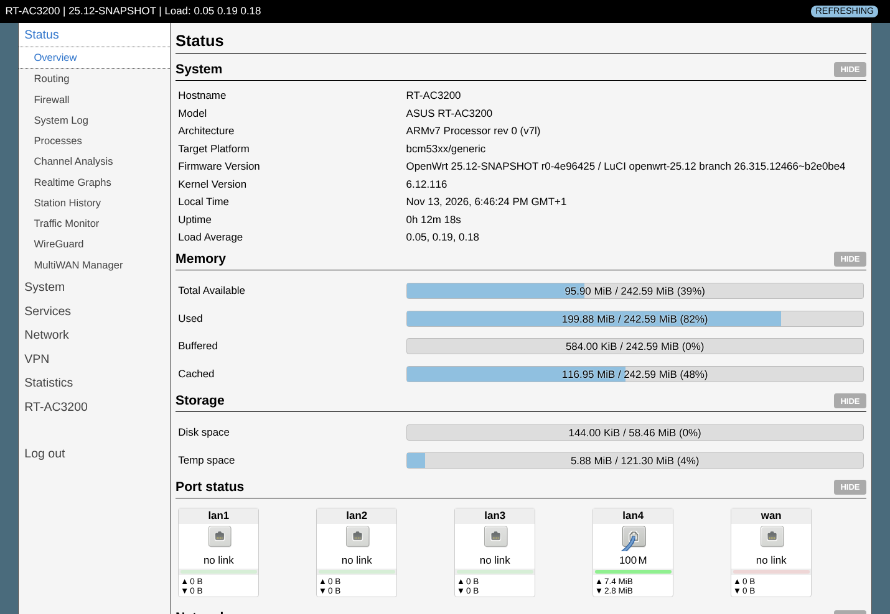
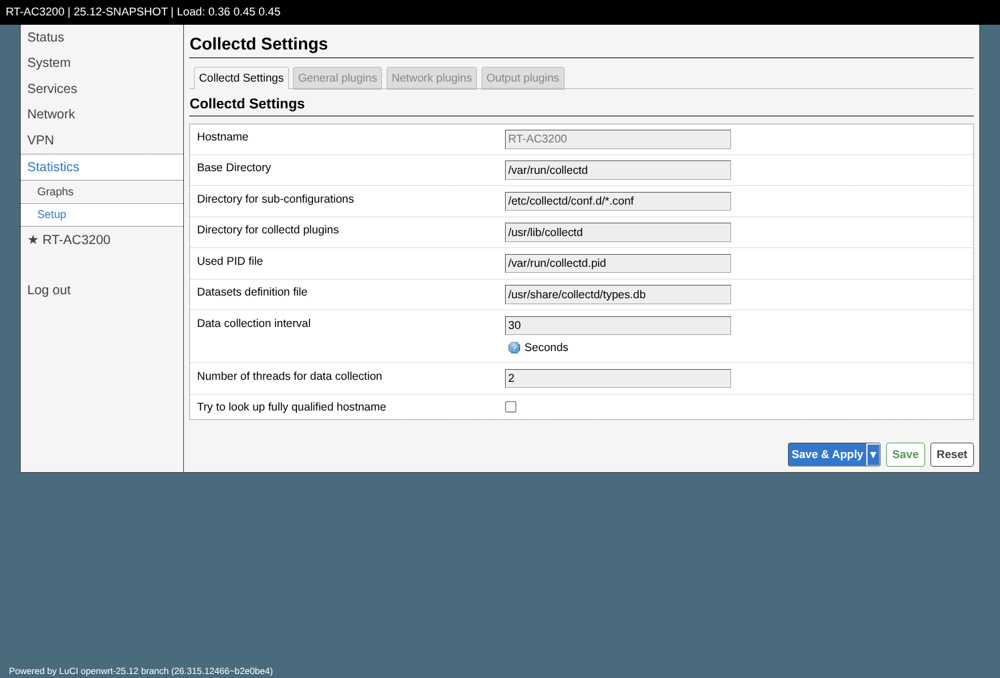
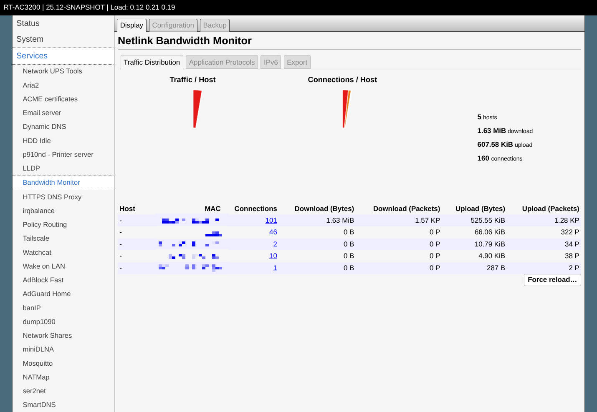
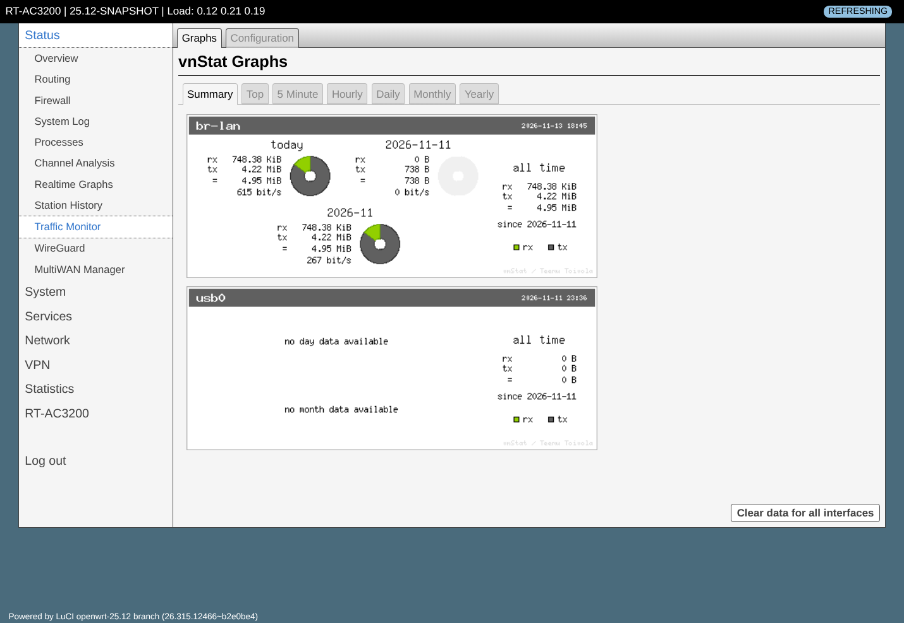
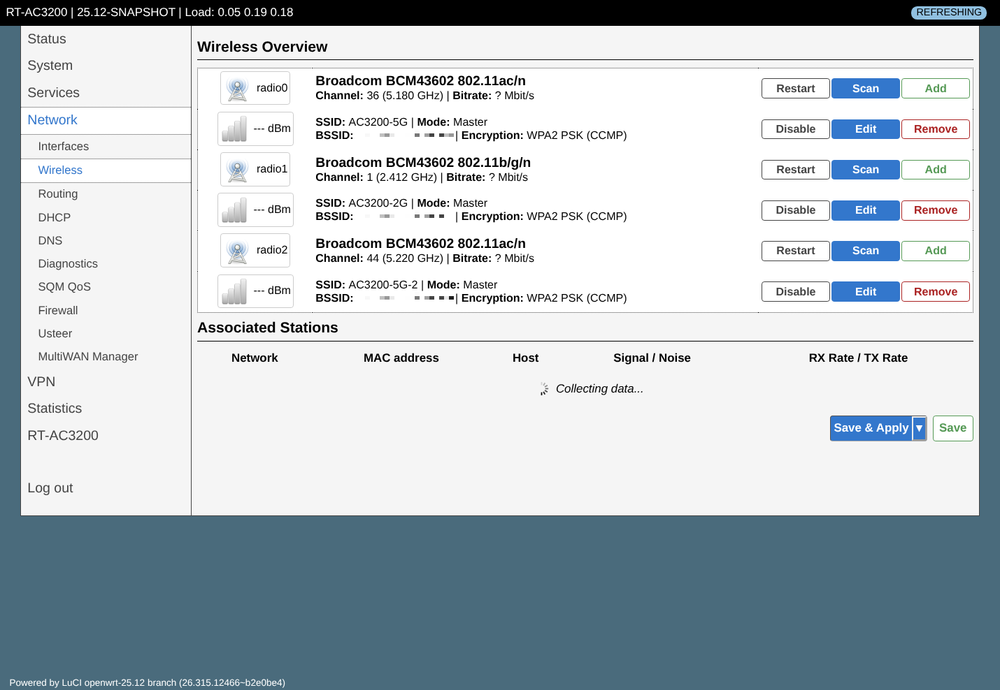
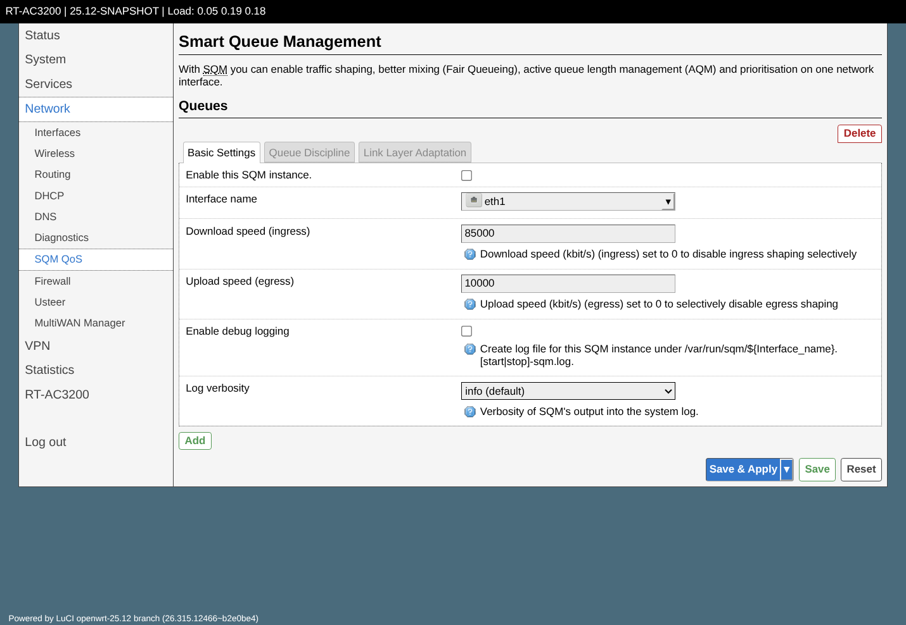
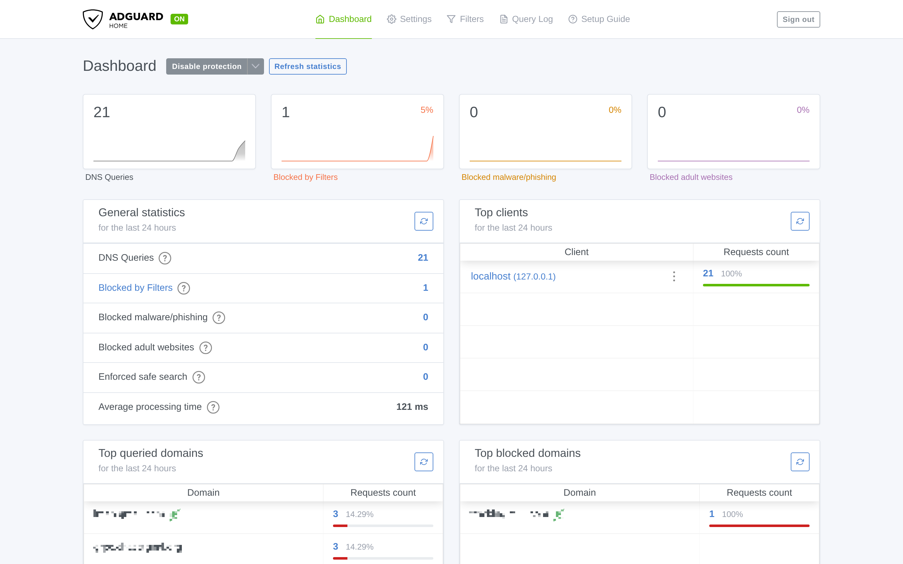
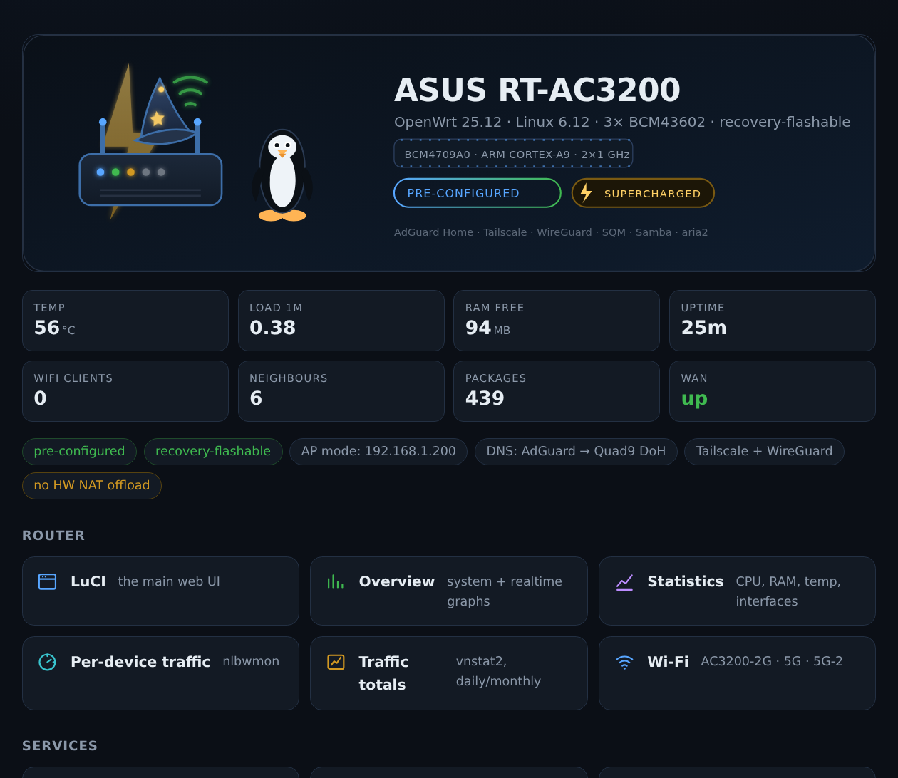

# ASUS RT-AC3200 — OpenWrt 25.12 build

<p align="center"></p>

**Project and packaging: [@ImAthanasia](https://github.com/ImAthanasia).**
**Start here: [what this router can do now](docs/use-cases.md) — the feature list and the real-world scenarios.**

An OpenWrt build for the **ASUS RT-AC3200** that is already set up when it boots. You flash it through
ASUS recovery mode, so no serial console is involved. Every number on this page was read off a real
unit, not copied from a datasheet.

I started this because the router was still fine and the software was not. It has been the actual
AP in my flat while I worked on it, so most of what follows is the result of things breaking at
inconvenient moments: two images that would not boot (bad flash writes, not config), a 5 GHz radio
that looked broken until it turned out the stock config disables all radios, and an LED re-apply
that exists because something resets the triggers late in boot.


## Why bother

ASUS stopped shipping firmware for this model years ago. The last stock build, and the last Merlin
build (384.13_10, June 2020), run Linux 2.6.36. That kernel gets no security fixes, and nothing modern
runs on it: no Tailscale, no WireGuard, no current AdGuard Home. The hardware is still fine, so I put
a current OpenWrt on it.

---

## What it does

A short list; the long version with before/after is in [`docs/use-cases.md`](docs/use-cases.md).

* Blocks ads and trackers for every device on the LAN (AdGuard Home, per-device stats, DoH).
* Reaches your home network from anywhere with Tailscale, no ports opened.
* WireGuard, OpenVPN and ocserv servers for the family.
* Turns a USB disk into a share (SMB3 + DLNA) and can run apps from that disk instead of NAND.
* Adds a network printer (p910nd), a serial port over IP (ser2net) and USB-over-IP (usbip).
* Uses any Android phone as a 4G/5G backup WAN over USB (tested), with mwan3 failover available.
* Shows where the bandwidth goes: nlbwmon per device, vnstat2 totals, collectd graphs.
* Keeps calls smooth on a busy line with SQM/cake, and steers clients to 5 GHz with usteer.
* Works as a Wi-Fi repeater/client (travelmate), IPTV proxy (udpxy), and blocklist firewall (banip).
* Runs a kernel that still gets fixes; the image is replaced by re-flashing, not by an in-place updater.

## Hardware

Read from `ubus`, `dmesg`, `/proc/mtd` and `iw` on the running box.

| | |
|---|---|
| SoC | Broadcom **BCM4709A0**, ARMv7 Cortex-A9, 2 cores @ 1 GHz, L310 L2 |
| RAM | 256 MB DDR3 |
| Flash | 128 MB NAND (Spansion/AMD, 2 KB page, BCH8 ECC), UBI over the full 126 MB region |
| Wi-Fi | **3× BCM43602** over a PLX PEX8603 PCIe switch: 2× 5 GHz + 1× 2.4 GHz, 3×3 |
| Ethernet | 4× GbE LAN + 1× GbE WAN (BCM53012 switch in SoC) |
| USB | 1× USB 3.0 (xHCI) + 2× USB 2.0 (EHCI/OHCI) |
| Serial | internal 4-pin **3.3 V TTL** header, 115200 8N1 (not needed for flashing) |
| Recovery | ASUS CFE web/TFTP recovery at 192.168.1.1 |

## What is already configured

All of this is on the image, set up on first boot. Nothing here needs a terminal.

| Area | What you get |
|---|---|
| **Wi-Fi** | tri-band AP: `AC3200-2G` ch1 (20 MHz), `AC3200-5G` ch36 and `AC3200-5G-2` ch44 (40 MHz) — WPA2-PSK, country PL, bridged to LAN |
| **DNS / adblock** | **AdGuard Home** (DNS on 127.0.0.1:5353, Quad9 DoH upstream, AdGuard filter on); dnsmasq → AdGuard → upstream with automatic fallback |
| **VPN** | Tailscale (+LuCI), kernel WireGuard (+LuCI), OpenVPN client/server, ocserv (AnyConnect-compatible) |
| **QoS** | SQM / cake |
| **Stats** | collectd RRD graphs (CPU, load, RAM, disk, interfaces, per-radio iwinfo), per-device `nlbwmon`, `vnstat2` totals, Wi-Fi history, web terminal (`ttyd`) |
| **Storage** | ksmbd SMB3 + wsdd2, ext4/NTFS3/exFAT automount, SMART, one-command **extroot** to a USB drive |
| **SIM / LTE** | MBIM + Option + usb-modeswitch so a **USB LTE/5G stick** becomes a WAN; `mwan3` failover + `pbr` policy routing |
| **Ops** | GUI package manager (apk), `banip`, `lldpd`, e-mail notifications, `udpxy` (IPTV), `smartdns`/`cloudflared`/`https-dns-proxy`, `mosquitto` (MQTT), `ustreamer`, `nut` (UPS), `dump1090` (SDR) |
| **AP mode** | LAN static 192.168.1.200/24, gateway + DNS 192.168.1.1, **DHCP off** (the upstream router keeps DHCP) |
| **One-click commands** | *System → Custom Commands*: "USB drive → overlay (extroot)", "list block devices", "restart AdGuard Home", "wireless status" |
| **Project page** | *Services → RT-AC3200* opens the authenticated LuCI project page (menu entry + ACL are baked in) |
| **Hygiene** | root password set (no blank password), logs capped at 256 KB in RAM (nothing written to NAND) |

The current image has 448 packages, is 59.1 MB, and leaves about 55 MB of writable space on NAND.

## Builds

| Build | Size | Contents |
|---|---|---|
| **v1.4** | 59.1 MB | **current release** — 5 GHz at 40 MHz on both radios, FAT32 + mkfs on the router, aria2 starts by itself when a disk is mounted (verified: 93.8 MB/s write, 103.4 MB/s read), model string and ★ menu entry (448 packages). |
| v1.0 - v1.3 | 58.7-59.1 MB | earlier releases: 20 MHz 5 GHz, then 40 MHz, then USB/FAT support |
| v5.1 / v5 / v4 / v3 | 53–57 MB | internal builds, kept for the bisect history |
| **v2-ac3200-full-featured** | 34 MB | known-good fallback — AdGuard, Tailscale, WireGuard, OpenVPN, SQM, stats, SMB, USB (315 packages) |
| v1-ac3200-basic | 33 MB | packages only, no baked AP/Wi-Fi config |
| *(revert)* | — | to go back to ASUS firmware, use the [ASUS RT-AC3200 support page](https://www.asus.com/us/supportonly/rt-ac3200/helpdesk_download/) (Firmware Restoration + stock firmware) |

Images are attached to **Releases** (see `firmware/README.md`). `SHA256SUMS` in every release.

## Screenshots

Captured from a running unit (headless Chromium, 1440×900 @2x) — the same pages you get after flashing.

| | |
|---|---|
|  |  |
| **Status → Overview** — system, interfaces, realtime graphs | **Statistics** — collectd RRD graphs (CPU, load, RAM, temp, interfaces) |
|  |  |
| **Per-device traffic** — nlbwmon top talkers | **Traffic totals** — vnstat2 daily/monthly |
|  |  |
| **Wireless** — the three BCM43602 radios | **SQM / cake** — bufferbloat control |
|  |  |
| **AdGuard Home** — DNS filtering dashboard | **In-router project page** — authenticated LuCI page (repo + recovery links) |

## Flashing

The stock ASUS and Merlin web UIs refuse this image. They only accept firmware signed by ASUS, and
answer with "Invalid Firmware Upload … certification rule". Recovery mode does not check the
signature, so flash from there:

1. Power off. Hold **Reset**, power on, keep holding until the **Power LED blinks slowly** (~5–10 s), release.
2. PC: static IP `192.168.1.10/24`, gateway `192.168.1.1`, cable to a **LAN** port.
3. Flash with either:
   * **ASUS Firmware Restoration** utility (Windows) — from the
     [ASUS RT-AC3200 support page](https://www.asus.com/us/supportonly/rt-ac3200/helpdesk_download/), or
   * plain TFTP: `curl -T openwrt-…trx tftp://192.168.1.1/`
4. Wait 5–10 minutes; it reboots into OpenWrt. First boot applies the baked defaults.

Going back to ASUS firmware: same procedure with `RT-AC3200_384.13_10.trx`.
**Never** use 30-30-30 on this board (Broadcom ARM).

After the first boot, extra software comes from LuCI → *System → Software* (`apk`). The image
itself is updated by flashing a newer release; there is no in-place updater in this build.

## Credentials

| | user | password |
|---|---|---|
| SSH / LuCI | `root` | `ac3200-admin` |
| AdGuard Home | `admin` | `ac3200-admin` |

Change both after flashing: `passwd`, and AdGuard → Settings.
The root hash is set by `scripts/first-boot/96-rootpass.sh`; the AdGuard hash lives in
`scripts/first-boot/adguardhome.yaml` (schema generated by the real binary, so it upgrades cleanly).

## Updating this build

Attended Sysupgrade is **not installed on purpose**. If it were, it would build a plain OpenWrt
image for the device and replace this build, throwing away the baked configuration and the extra
packages. Flash a new release from this repo instead.

Updates come from this repository: download the newest `.trx` from Releases and flash it through
recovery mode (or `sysupgrade` from SSH). Settings live in the overlay and survive a reflash that
keeps them; a recovery-mode flash starts from the baked defaults.

## Things that do not work, and why

1. **5 GHz runs at 40 MHz, not 80.** `VHT80` is refused by the driver and no regulatory domain
   changes that; `VHT40` on channels 36+40 and 44+48 works, so both 5 GHz radios are usable. Channels 52-140 are receive-only (no DFS
   for AP mode) and 149+ are disabled. The old note about the second 5 GHz radio being off is
   obsolete — it was `disabled '1'` in the stock wireless config, plus the 80 MHz failure. `brcmfmac` needs a
   regulatory file called `brcmfmac43602-pcie.clm_blob` that linux-firmware does not ship. Without it
   the radio stays on the "world" domain, and anything above channel 48 is refused. Both 5 GHz radios
   would end up on channel 36, so one is left disabled. Your ASUS firmware used channel 36 and 100,
   which means the chip can do it. The missing file is the only reason it cannot here.
   *Possible fix:* carve it from `RT-AC3200_384.13_10.trx` (`dhd.ko`) or the intact `nvram` partition.
2. **No hardware NAT.** Broadcom never released an offload driver for this SoC, so routing is done on
   the CPU. Expect 600-900 Mbit/s on a gigabit line.
3. **Wi-Fi is access point only.** The FullMAC driver cannot act as a client or do WDS. AiMesh and
   AiProtection are ASUS software and are not here.
4. **No custom LuCI skins.** LuCI was rewritten in 24.10 and the old themes (argon and friends) no
   longer work. I tried the four themes that ship with 25.12 as well; they install but render a blank
   content area, so the default theme is pinned.

## Repository layout

```
docs/                 flash-guide, build, hardware, limitations, notes-from-Merlin, use-cases, clm-research, features-preview.html
scripts/first-boot/   the exact uci-defaults + configs baked into the image (source of truth)
router-page/          rtac3200.html — the in-router project page (drop into files/www + rebuild)
images/               screenshots used by this README
firmware/             how to get the .trx images (Releases)
```

## Rebuilding

```
git clone https://git.openwrt.org/openwrt/openwrt.git -b openwrt-25.12
cd openwrt
# target bcm53xx/generic, device asus_rt-ac3200, plus the package list in docs/build.md
./scripts/feeds update -a && ./scripts/feeds install -a
scripts/config/conf --olddefconfig Config.in
make -j$(nproc)
# cp -a <repo>/scripts/first-boot/* files/etc/...  (see docs/build.md for the mapping)
```

Host deps and the two build quirks (tar ownership on root-owned hosts, LuCI/pbr package conflicts)
are documented in `docs/build.md`.

## Credits & licensing

* Base: [OpenWrt](https://openwrt.org) (GPL-2.0) — device support for `asus,rt-ac3200` and
  mainline `bcm4709-asus-rt-ac3200.dts` come from upstream.
* Fallback image: [Asuswrt-Merlin](https://github.com/RMerl/asuswrt-merlin.ng) 384.13_10
  (proprietary ASUS/Broadcom components, redistributed as-is for personal recovery use only).
* Recovery utility / stock firmware: ASUS.
* This repository's build scripts, first-boot configs and documentation: **GPL-2.0**.

Not affiliated with ASUS, Broadcom, OpenWrt or the Merlin project. Flash at your own risk.
